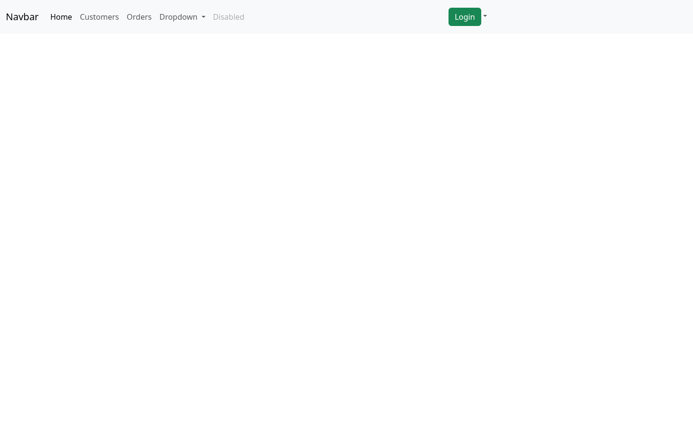
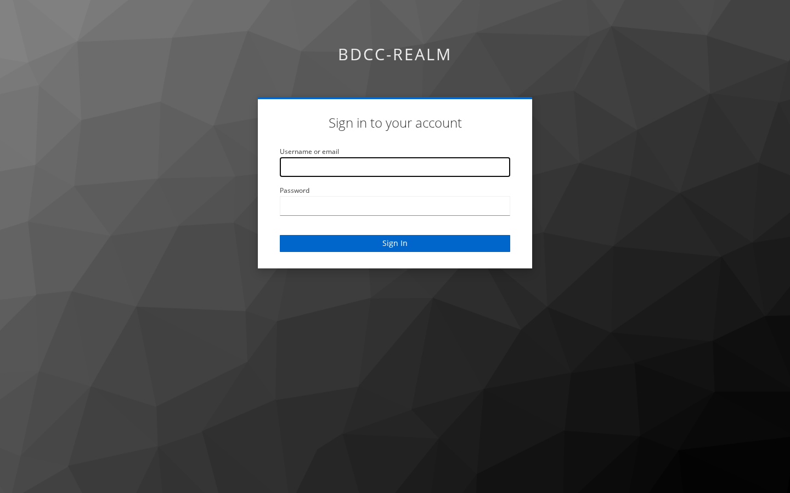
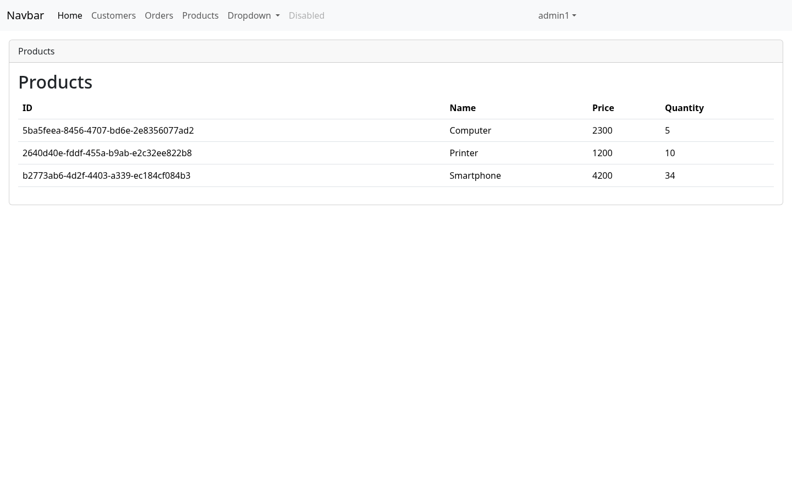
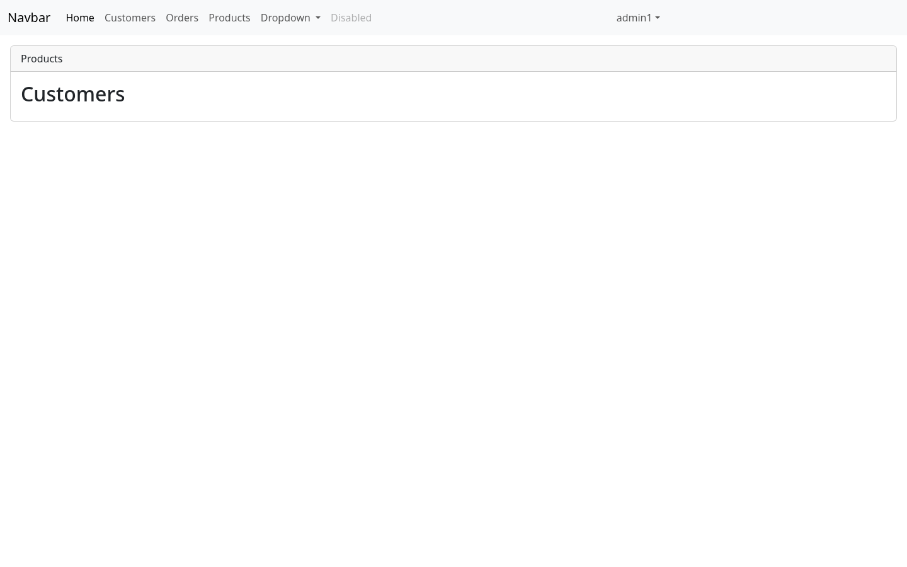
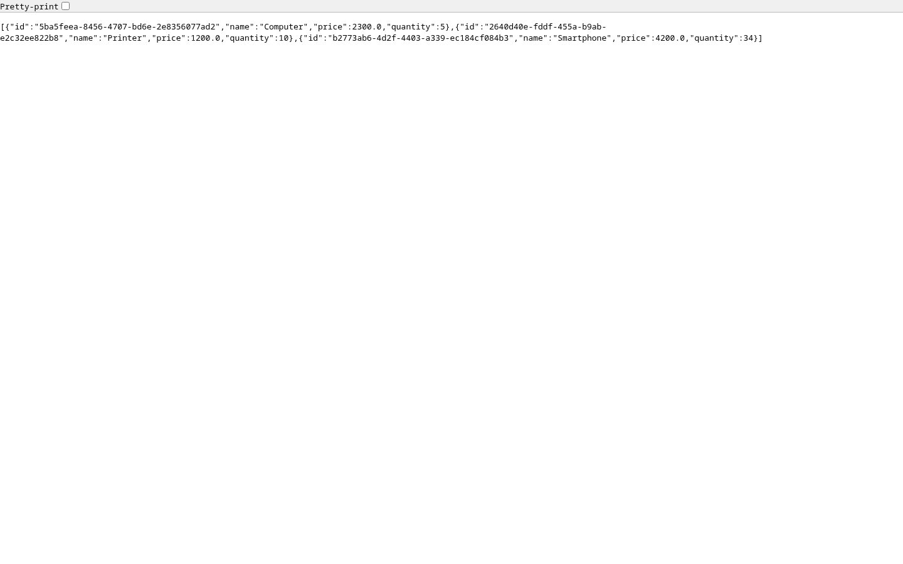
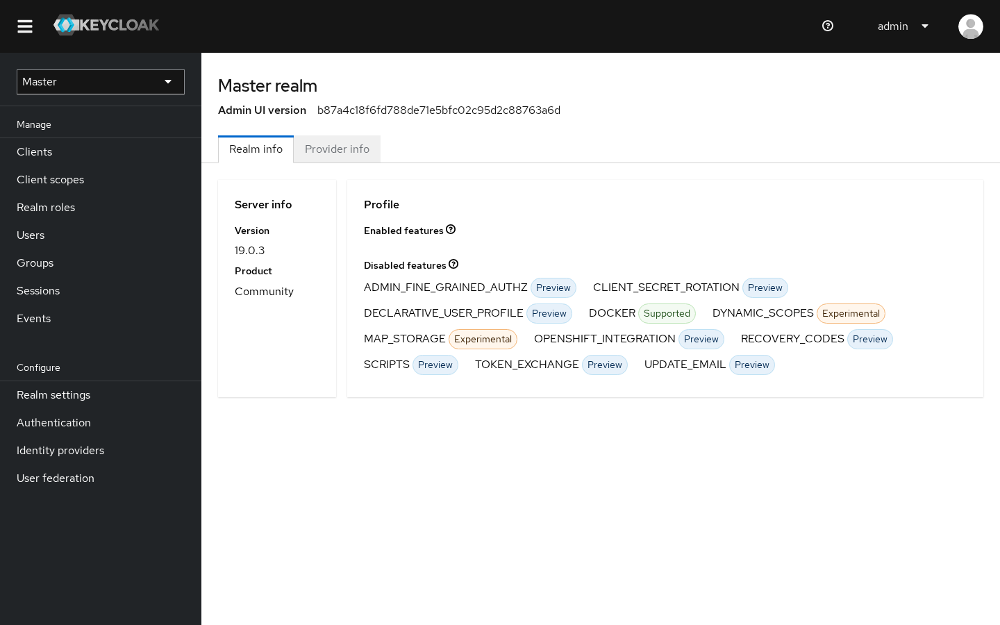

# mouss.com — OAuth2 / OIDC / Keycloak

Démonstration d'une architecture distribuée sécurisée : un frontend Angular et un microservice Spring Boot
protégé par Keycloak (OAuth2 / OpenID Connect, JWT access tokens).

## Structure

| Module | Description | Port |
| --- | --- | --- |
| `inventory-service` | API REST `/api/products`, resource server JWT | 8087 |
| `mouss-oidc-frontend` | Client Angular avec Keycloak Angular + guard de route | 4200 |
| Keycloak (Docker) | Serveur d'identité, realm `bdcc-realm`, client `ecom-client-ang` | 8080 |

## Démarrage

### 1. Keycloak

```bash
docker run -d --name keycloak -p 8080:8080 \
  -e KEYCLOAK_ADMIN=admin \
  -e KEYCLOAK_ADMIN_PASSWORD=admin \
  -v keycloak_data:/opt/keycloak/data \
  quay.io/keycloak/keycloak:19.0.3 start-dev
```

Console : http://localhost:8080/admin

Créer le realm `bdcc-realm`, le client public `ecom-client-ang` (Standard flow + Direct access grants),
les rôles `USER` et `ADMIN`, puis deux utilisateurs avec des mots de passe non temporaires.

### 2. Backend

```bash
cd inventory-service
./mvnw spring-boot:run
```

L'API refuse toute requête sans token JWT valide émis par Keycloak.

### 3. Frontend

```bash
cd mouss-oidc-frontend
npm install
npm start
```

Application : http://localhost:4200

## Captures

### Accueil de l'application



### Redirection vers la page de connexion Keycloak



### Liste des produits après authentification



### Espace clients protégé par le guard de rôle



### API refusant une requête sans token


### API répondant avec un JWT valide



### Console d'administration Keycloak



Toutes les captures sont dans [`docs/screenshots`](docs/screenshots).
